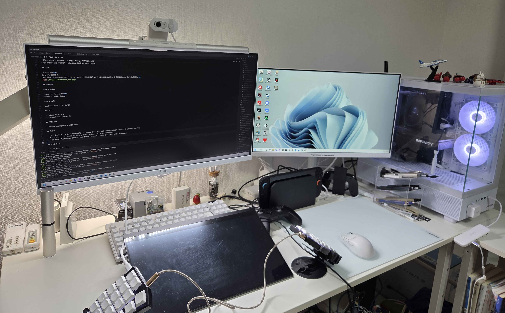
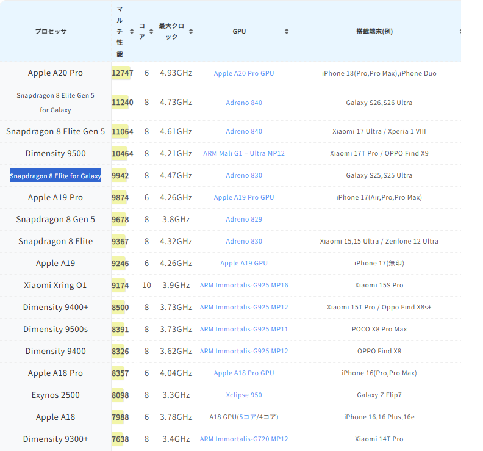

# ハードウェア

## PC

### デスクトップPC

- CPU: Ryzen 7 7700
- GPU: RTX 5060ti VRAM 16GB
- RAM: 32GB(16GBx2 ドスパラセレクトの安いやつ)
- SSD: 2TB(ADATAの安いやつ)
- マザボ: ASRock B650 PG LIGHTNING
- CPUクーラー: 虎徹Mark3
- 電源: 750W 80PLUS Bronzeのやつ(型番忘れた)
- ケース: Montechの安いやつ(型番忘れた)
- 用途: メイン機
- 妥協できることは妥協してある程度安く抑えた

### ノートPC(生協PC)

- 型番: FMVUUE003U
- CPU: Core Ultra 7 155H
- GPU: Arc(CPU内蔵)
- RAM: 16GB
- SSD: 256GB
- 用途: 大学の授業用, 外出先からメイン機を遠隔操作する用
- 選んだ理由: 軽さ, バッテリー持ち

### ノートPC(ゲーミング)

- 型番: 162941 GR1650TGF-T 
- CPU: Ryzen 5 4600H
- GPU: GTX 1650ti laptop
- RAM: 24GB(8+16GB, 増設した)
- SSD: 1TB(512+512GB, 増設した)
- 用途: 今は使ってないけど昔はメイン機として使ってた, 実験用に使うかも?
- 選んだ理由: 値段(7万円)で、一応Unityの最低要件は満たしていたから。

## スマホ

Galaxy S25 
ストレージ: 256GB 
選んだ理由: Snapdragon 8 Elite for GalaxyというSoCが購入当時で一番性能が良かったから。 & その前もGalaxy S10を使ってたから。 

## キーボード

### 普段使い

Corne v4 Chocolate 
キースイッチ: Kailh Sufer

### ゲーム用

Logicool PRO X TKL RAPID

## マウス

- Pulsar X2 v3 Mini
- Logicool G304(持ち運び用)

## マウスパッド

- Pulsar superglide 2 (420x330)

## モニター

- メイン: Pixio PX278 Wave White(27inch, 180Hz, 1ms, IPS, WQHD: 2560x1440)(Pixioのモニターアームに取り付けて使ってる)
- サブ: ViewSonic VX2428J2-W(24inch, 240Hz, 0.5ms, IPS, FHD: 1920x1080)
- 持ち運び用兼タブレットの代替: EHOMEWEI LQG-156PW(15.6inch, 144Hz, 1ms, IPS, WQHD: 2560x1440)

## モニターライト

- BenQ ScreenBar Pro

## NAS

- I-O DATAのやつ(型番は忘れた, 8TB, 実家に置いてある)

## ゲーム機

- Nintendo Switch
- Nintendo Switch2
- Wii
- Nintendo 3DS
- Nintendo DS
- PlayStation 3
- PlayStation Vita
